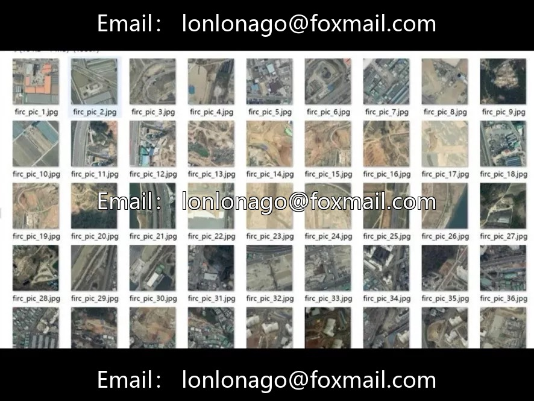
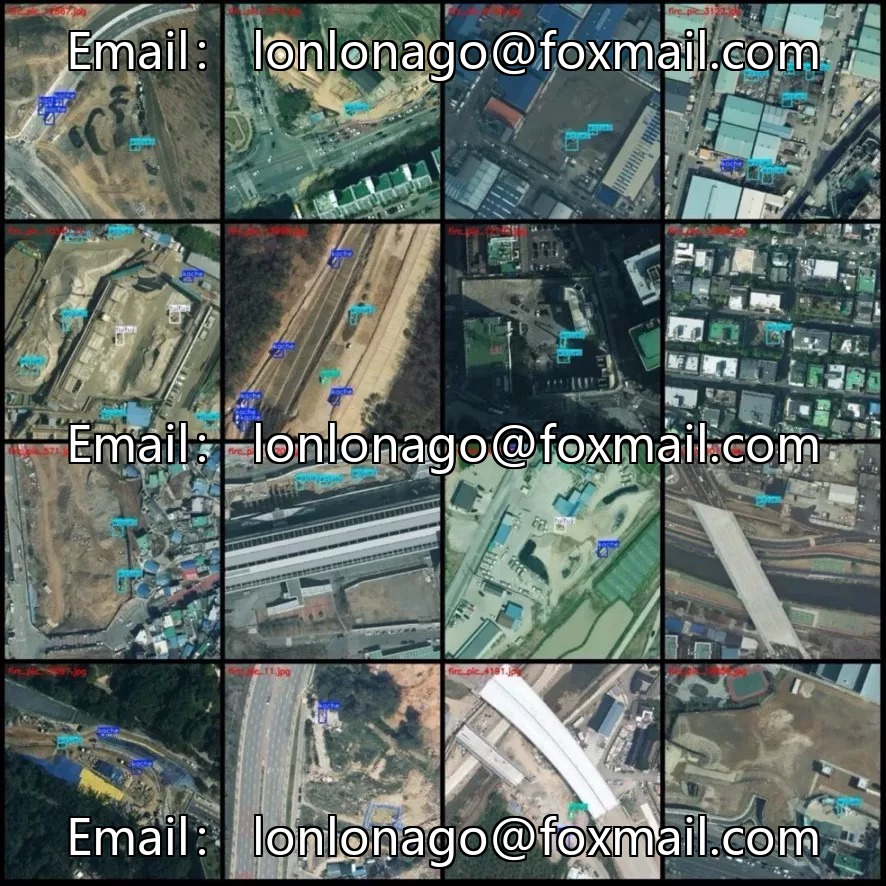
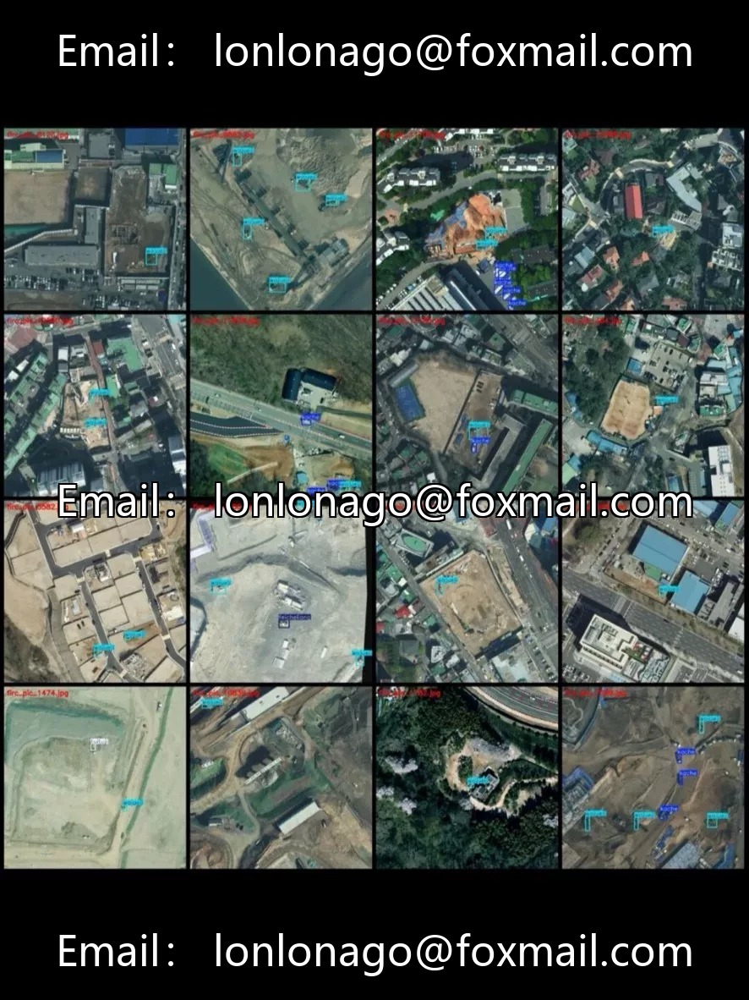

# Remote sensing vehicle detection dataset

## Body

Remote sensing vehicle detection dataset for remote image engineering vehicles detection dataset, 13867 remote sensing images with a resolution of 640×640, VOC+YOLO dual format, 6 classes of engineering vehicles, total labeled bounding boxes 39224, including excavators, trucks, bulldozers, rollers, graders, non-vehicles. Excavators have the most (25707 bounding boxes, covering 12747 images), trucks second (10499 bounding boxes), bulldozers 1806, rollers 655, graders 269, non-vehicles 288. The distribution of categories is extremely unbalanced, with excavators and trucks accounting for 92% of the total labeled bounding boxes. Some of the data in the dataset includes rotated enhanced images.

Remote sensing image characteristics: aerial view, vehicles appear in top-view form, relatively small in size, with complex backgrounds (construction sites, mining areas, barren land, roads mixed). Engineering vehicles are usually small targets in remote sensing images, and may only have dozens of pixels at a resolution of 640×640.

Application scenarios: construction site progress monitoring, mining area vehicle scheduling statistics, national land remote sensing survey, urban engineering supervision. No training, validation, or test sets are divided; you need to divide them yourself at an 8:1:1 ratio. Suitable for remote sensing target detection, smart construction sites, engineering management projects.

Virtual materials, once sold, are non-refundable.
Interested friends, click "I want" to proceed.

## Images

## Payment

Here is a pay link on Stripe ( https://buy.stripe.com/3cs8yP7sY87d0vu9AB ). Please contact me lonlonago@foxmail.com after funding $89, and I will send you a complete data files , thank you!

